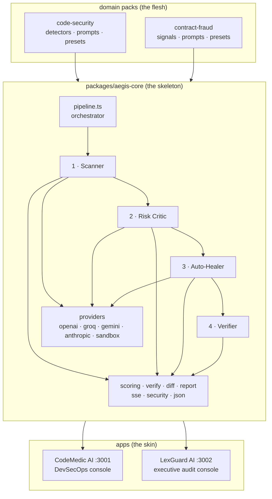
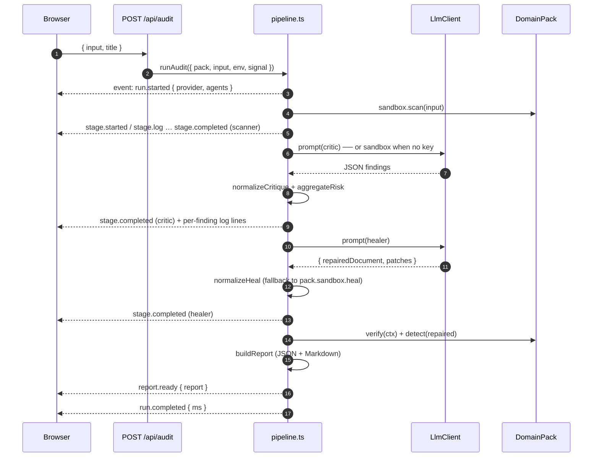
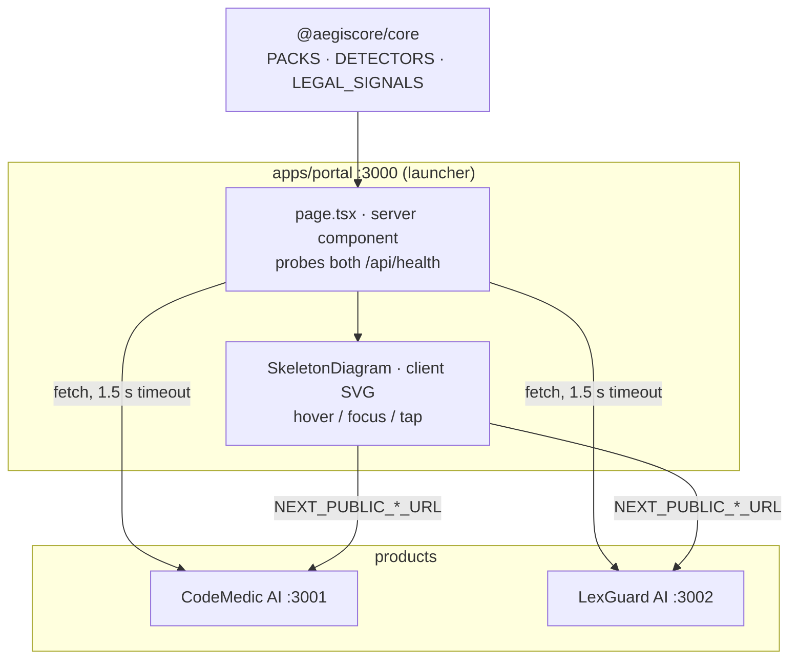
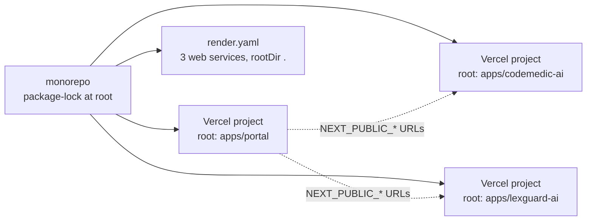

# AegisCore — Design

## 1. Problem

Security review and contract review are the same workflow wearing different clothes:

1. read an artefact,
2. locate the parts that can hurt you,
3. score them,
4. produce a safe replacement,
5. prove the replacement is actually safe.

Most "AI agent" demos hard-code one of those steps to one domain. AegisCore isolates the
workflow and lets a domain supply only the vocabulary: what a chunk is, what a finding is,
what "safe" means, and how to rewrite.

## 2. Skeleton view



The core knows nothing about SQL or indemnity clauses. A pack supplies:

```ts
interface DomainPack {
  id: string;
  label: string;
  documentNoun: string;
  actionLabel: string;
  agents: Record<AgentStage, AgentDescriptor>; // names, roles, accent colours
  presets: Preset[];                            // one-click demo inputs
  prompts: Record<AgentStage, (ctx: PipelineContext) => PromptPair>;
  sandbox: {
    scan(input: string): ScanResult;
    heal(input: string, scan: ScanResult, critique: CritiqueResult, title?: string): HealResult;
  };
  detect(input: string): Finding[];              // verification oracle
  verify(ctx: PipelineContext): VerificationCheck[];
}
```

## 3. Pipeline data flow



Each `stage.log` is emitted with a small delay budget so a viewer can follow the reasoning
instead of receiving everything in one frame. The delay is a constant (`pace`) that the test
suite sets to zero, so tests run in milliseconds while the demo feels deliberate.

## 4. Scoring model

Severity is derived, never trusted from the model:

| Score | Severity | Band (run level) |
| --- | --- | --- |
| ≥ 85 | critical | critical ≥ 85 |
| 65–84 | high | severe ≥ 70 |
| 45–64 | medium | elevated ≥ 50 |
| 25–44 | low | guarded ≥ 25 |
| < 25 | info | minimal < 25 |

Run-level risk compounds findings so that "one critical + three mediums" outranks
"one critical alone":

```
risk = min(100, topScore + 0.25 × Σ(otherScores))
```

The model's own `riskScore` is preserved as `criticScore` for transparency and is displayed
in the report, but it never drives the gauge. This prevents a chatty model from inflating or
deflating the headline number.

## 5. Verification model

The verifier is deliberately adversarial to the healer. It is **deterministic code**, not a
model call:

| Domain | Check | Failure means |
| --- | --- | --- |
| code | `code.residual.critical` | a ≥ 75 detector still fires on the patch |
| code | `code.syntax.balance` | delimiters unbalanced after rewriting |
| code | `code.secret.leak` | a credential survives in the patch |
| code | `code.patch.applied` | the document did not change |
| contract | `legal.liability.cap` | no enforceable cap in the counter-document |
| contract | `legal.mutual.termination` | no mutual 30-day termination right |
| contract | `legal.redlines.applied` | a redline is missing from the counter-document |
| contract | `legal.rights.reserved` | no reservation of rights |
| contract | `legal.reconciliation` | invoice totals still do not reconcile |

Confidence starts at 98 and loses points per failed check and per fallback. The UI shows both
the pass/fail list and the confidence so a judge can see the engine auditing itself.

## 6. Streaming protocol

```
retry: 3000

event: stage.log
data: {"type":"stage.log","stage":"critic","level":"warn","message":"CRITICAL · SQL injection …","at":1795496622173}

```

- One JSON object per `data:` line, no newlines inside payloads.
- `X-Accel-Buffering: no` and `cache-control: no-store` prevent proxy buffering.
- The client parses frames from a `ReadableStream` and aborts via `AbortController`.
- Server-side abort is observed through `request.signal`, so a cancelled run stops work.

## 7. Provider abstraction

```ts
interface LlmClient {
  id: string;
  label: string;
  mode: "live" | "sandbox";
  complete(prompt: PromptPair, options?: { timeoutMs?: number; signal?: AbortSignal }): Promise<string>;
}
```

- Providers are plain `fetch` calls — no SDKs, no transitive dependency risk.
- `resolveLlmClient(env, pack)` picks the first configured provider unless `AEGIS_PROVIDER`
  forces one.
- The sandbox client throws `SandboxOnlyError`; the pipeline catches it and calls the pack's
  deterministic analyzer, so both paths converge on the same normalized types.
- Invalid model output is treated as a provider failure and falls back (R11).

## 8. Failure modes

| Failure | Behaviour |
| --- | --- |
| No API key | Sandbox mode; identical report shape; UI labels it |
| Provider timeout / 4xx / 5xx | `warn` log, fallback to sandbox for that stage |
| Model returns prose | JSON extraction fails → fallback, verification note recorded |
| Empty or oversized input | 400 before the stream starts, or `run.failed` |
| Client disconnects | `request.signal` aborts provider fetches and the generator |
| Healer produces nothing | `pack.sandbox.heal` repairs deterministically |
| Verifier finds a residual defect | `verification.passed = false`; the report says so |

## 9. Security model

- **Trust boundary:** the browser. Every request body is validated for type, emptiness, and
  length before any model call.
- **Secrets:** read from `process.env` only. Never returned by `/api/health` (only the provider
  id/label/mode). Provider error text is passed through `redactSecrets` before it reaches the
  UI, so a leaked key inside an upstream error cannot be echoed back.
- **Prompts:** user input is fenced inside `<document>` tags with an instruction to treat it
  as data; the domain rules live in the system prompt.
- **Rendering:** the UI never uses `dangerouslySetInnerHTML`. Code and documents render as
  text inside `<pre>`.
- **Limits:** `AEGIS_MAX_INPUT_CHARS` (default 200 000) bounds memory; the diff falls back to
  index-aligned comparison for documents over 800 lines.
- **No persistence:** runs are request-scoped; nothing is written to disk.

## 10. Performance

- One audit = 4 model calls (or 0 in sandbox). Sandbox runs complete in ~2.5 s including
  streaming pacing; the deterministic computation itself is < 20 ms.
- No database, no queue, no worker pool — memory stays flat and the demo runs on a laptop.
- `next build` output: ~115 kB first-load JS per app, shared chunks reused.

## 11. Testing strategy

- `node:test` + `tsx`, no test framework dependency.
- Tests cover: JSON extraction, normalization, diff classification, input clamping, secret
  redaction, provider selection, every preset end-to-end in both domains, streaming event
  order, failure paths (empty input, broken provider), and SSE frame encoding.
- The pipeline accepts an injectable `llm` client and a zero `pace`, so tests exercise real
  code paths without network access.

## 12. Trade-offs

| Decision | Why | Cost |
| --- | --- | --- |
| Deterministic analyzers alongside the LLM | Judges must get a great demo with no keys; verification needs a non-model oracle | Two implementations of domain knowledge, kept in sync by tests |
| Next.js route handlers instead of FastAPI | One command, one language, one deploy target | No Python ecosystem; streaming must respect Next's runtime |
| Rule-based detectors rather than embeddings | Explainable, fast, deterministic, zero cost | Narrower coverage than a semantic scanner |
| Compounding risk formula | Rewards breadth of findings | Saturation at 100 for multi-critical inputs |
| No persistence | Zero setup friction for judges | Runs cannot be revisited by URL |

---

## 13. Phase 2 — delivery surfaces



The portal is the third consumer of the skeleton: it renders the same `PACKS` registry, the
same detector inventory and the same signal inventory that the products execute. Nothing on
the page is a hard-coded marketing number.

### File intake

```
File (drag | pick)
   └─ readUploadedText(file, { extensions, maxBytes })        packages/aegis-core/src/client.ts
        ├─ extension allow-list      → reject: "Unsupported file type. Accepted: …"
        ├─ size 0                    → reject: "That file is empty."
        ├─ size > limit              → reject: "File is X — the limit is Y."
        ├─ NUL byte present          → reject: "That looks like a binary file…"
        ├─ strip BOM, trim check     → reject: "That file has no readable content."
        └─ ok → { name, text, bytes } → editor + document label
```

The validation lives in the core so both apps cannot drift; the drop zone is styled
independently (cyan console vs amber desk) because the two products must not share a look.

### Print pipeline

| Layer | Mechanism |
| --- | --- |
| Screen chrome | `print:hidden` on header, panels, tabs, footer, background layers |
| Printable artefact | `PrintSheet` rendered with `hidden print:block`, black-on-white |
| Page setup | `@page { size: A4; margin: 14mm }` in the app stylesheet |
| Colour fidelity | `print-color-adjust: exact` so the paper tones survive Chrome's print engine |
| Control | Header button, disabled until a signed report exists |

The print sheet is generated from the `AuditReport`, not by screenshotting the dashboard, so
the PDF contains the full findings table and the entire counter-proposal even when those
panels are scrolled out of view.

### Deployment topology



Provider precedence in production:

```
DEMO_MODE truthy ────────────────► sandbox (always)
AEGIS_PROVIDER=<id> ─────────────► that provider, if configured
first configured of ─────────────► openai → gemini → groq → anthropic
nothing configured ──────────────► sandbox
```

`/api/health` reports the resolution result (`active.id`, `mode`, `demoMode`) so the portal and
the product badges always agree with the server.
