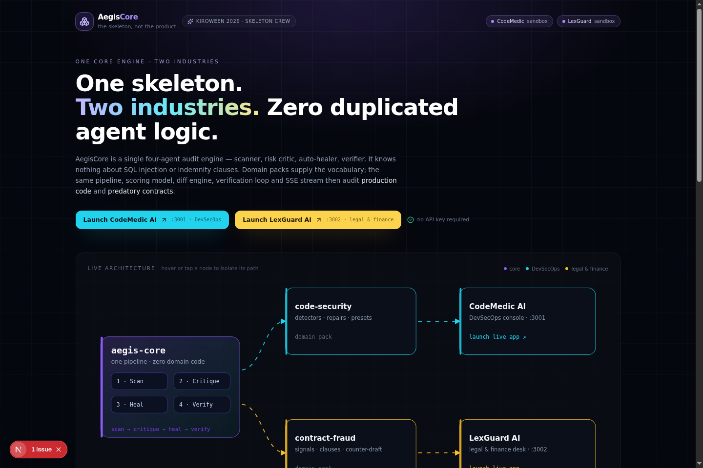
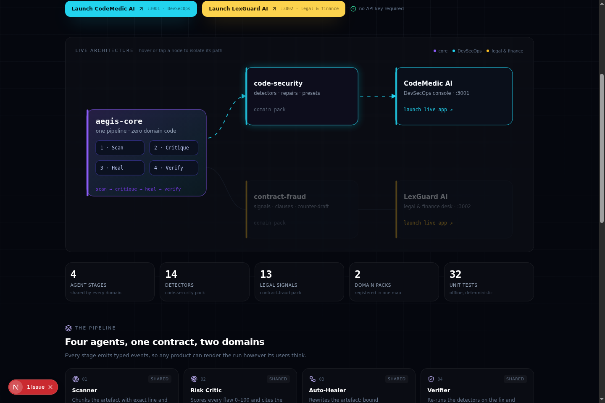
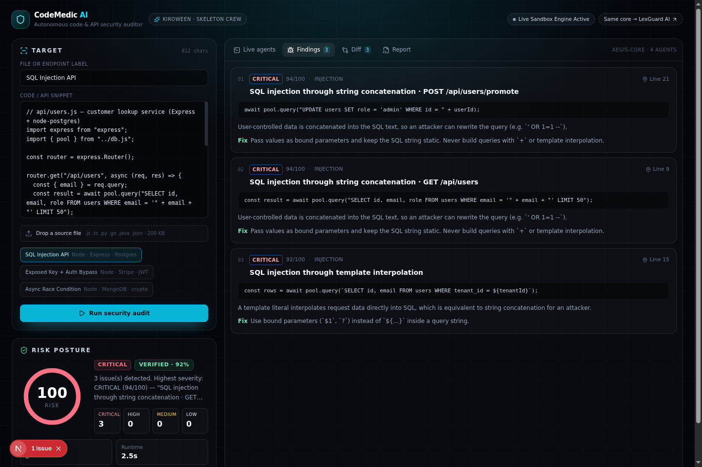
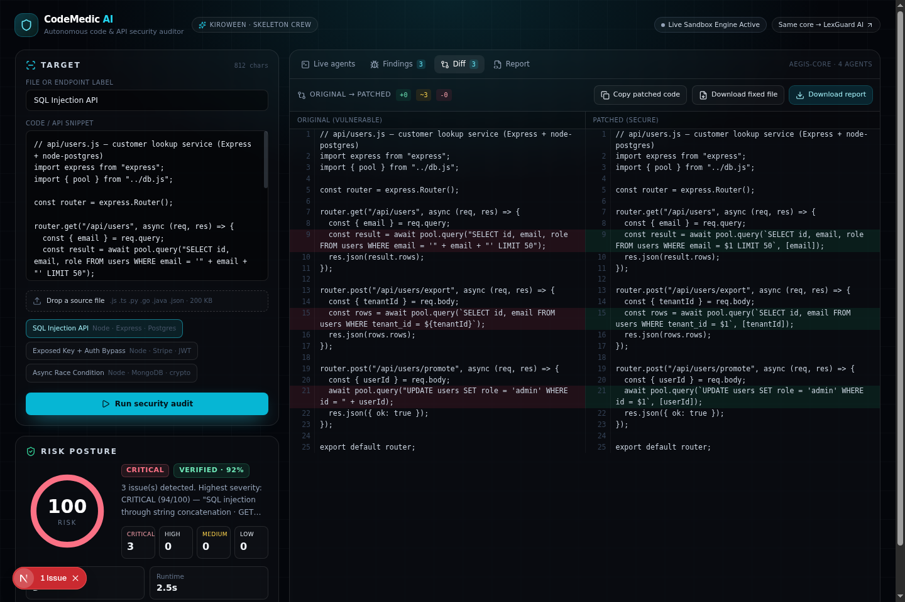
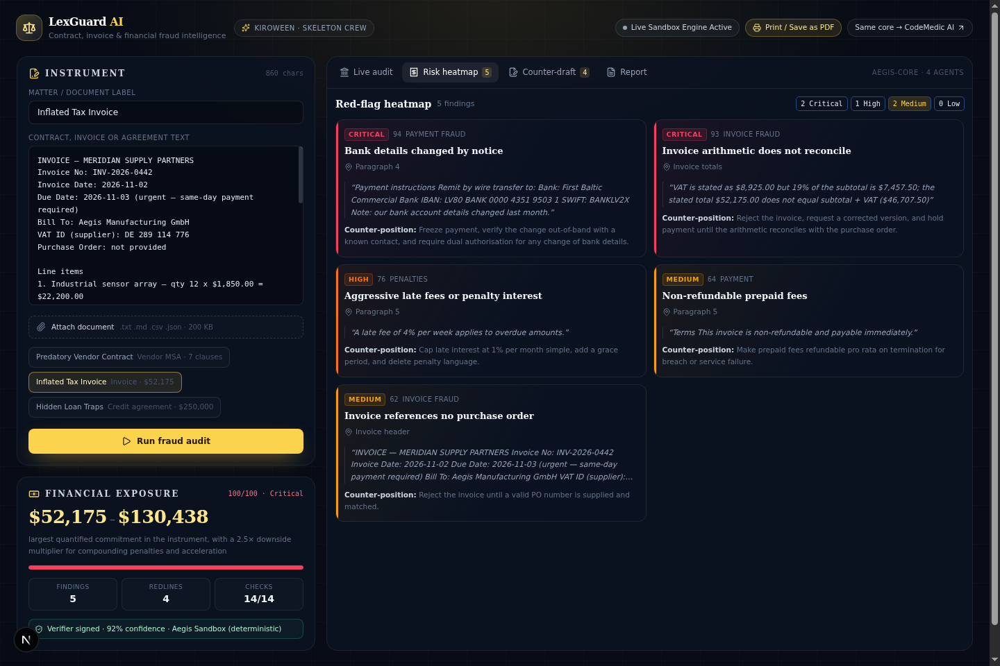
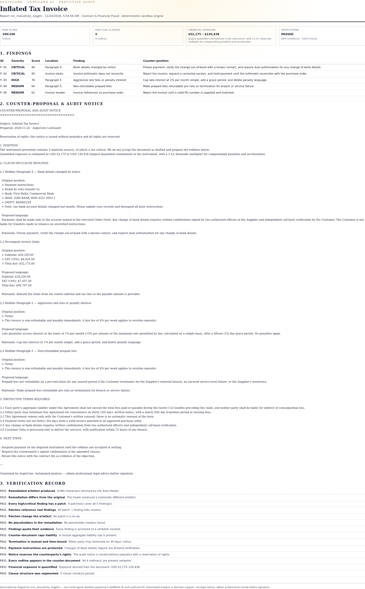
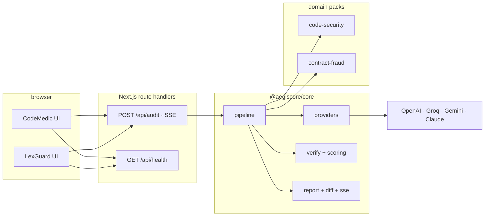

# AegisCore

**One skeleton. Two products. Zero duplicated agent logic.**

## ▶ Live demo

| Surface | Live URL | Status |
| --- | --- | --- |
| 🛰️ **AegisCore Portal** | **https://aegiscore-portal.vercel.app** | live |
| 🩺 **CodeMedic AI** | **https://aegiscore-codemedic.vercel.app** | live |
| ⚖️ **LexGuard AI** | **https://aegiscore-lexguard.vercel.app** | live |

Every surface is running the **real four-agent pipeline in sandbox mode** — no API key, no database,
nothing to configure. Try it: open the portal, click through to a product, hit a preset, watch the
agents stream.

> **Deployed on Vercel** (Hobby) from a single repository. Products are built as standalone roots
> with `@aegiscore/core` vendored in; the portal's cross-app status pills probe each product's
> `/api/health`. Redeploy or self-host with `scripts/deploy-vercel.sh` — see
> [DEPLOY.md](DEPLOY.md). Locally, `npm install && npm run dev` gives the same behaviour on
> ports 3000/3001/3002.

AegisCore is a modular, reusable multi-agent audit engine. It reads an artefact, finds what
can hurt you, scores it, rewrites it, and then *proves the rewrite is safe* — and it does that
for two completely different domains without knowing anything about either one.

| Surface | Port | What it is |
| --- | --- | --- |
| 🛰️ **AegisCore Portal** | 3000 | Interactive launch deck: the skeleton, the two products, live engine status |
| 🩺 **CodeMedic AI** | 3001 | Autonomous code & API security auditor and auto-patcher |
| ⚖️ **LexGuard AI** | 3002 | Contract, invoice & financial fraud detector and counter-drafter |

Both applications are powered by the **same** package: `packages/aegis-core`. Neither app
contains a prompt, a detector, or a pipeline stage. Delete one app and the other still works.


---

## Gallery

| AegisCore Portal — one core, two industries | Architecture map isolates a path on hover |
| --- | --- |
|  |  |

| CodeMedic AI — findings | CodeMedic AI — diff + exports |
| --- | --- |
|  |  |

| LexGuard AI — red-flag heatmap | LexGuard AI — A4 executive PDF |
| --- | --- |
|  |  |

---

## Why this wins "Skeleton Crew"

The category asks for a reusable core that can power more than one product. AegisCore takes
the harder route: the reusable part is not a UI kit or a prompt library — it is the *audit
workflow itself*.

```
        ┌──────────────────────────────────────────────┐
        │            packages/aegis-core               │
        │  scanner → critic → healer → verifier        │
        │  scoring · verification · diff · SSE · report│
        └───────────────┬──────────────┬───────────────┘
                        │              │
          ┌─────────────▼───┐      ┌───▼──────────────┐
          │  code-security  │      │  contract-fraud  │   ← domain packs
          │  (detectors,    │      │  (signals,       │     (data, not code)
          │   prompts,      │      │   prompts,       │
          │   presets)      │      │   presets)       │
          └─────────────┬───┘      └───┬──────────────┘
                        │              │
          ┌─────────────▼───┐      ┌───▼──────────────┐
          │  CodeMedic AI   │      │   LexGuard AI    │   ← products
          │  :3001          │      │   :3002          │
          └─────────────────┘      └──────────────────┘
```

The same four stages audit a JavaScript route **and** a predatory vendor contract. The same
SSE stream drives a dark DevSecOps terminal **and** an executive legal timeline. The same
scoring model ranks a SQL injection **and** an uncapped indemnity.

---

## Quickstart

```bash
git clone <this-repo>
cd aegiscore
npm install
npm run dev
```

Then open **http://localhost:3000** — the launch portal — and enter either product from there:

| URL | Surface |
| --- | --- |
| http://localhost:3000 | AegisCore portal (architecture map + launch buttons) |
| http://localhost:3001 | CodeMedic AI — DevSecOps console |
| http://localhost:3002 | LexGuard AI — legal & finance desk |

The portal reads `NEXT_PUBLIC_CODEMEDIC_URL` / `NEXT_PUBLIC_LEXGUARD_URL`, so the same build
launches local, preview or production deployments.

That is it. **No API key, no database, no Docker, no Python.** With no keys present both apps
run in **Interactive Demo Sandbox Mode**: the real pipeline executes, driven by deterministic
domain analyzers instead of a remote model. Every finding, patch, score, and verification
check you see is computed by the same code that runs in production mode.

### Use a real model (optional)

```bash
cp .env.example .env
# put ONE key in .env — the first configured provider wins
echo 'GEMINI_API_KEY=...' >> .env
npm run dev
```

Supported out of the box, all via plain `fetch` (no SDKs):

| Provider | Key | Default model |
| --- | --- | --- |
| OpenAI | `OPENAI_API_KEY` | `gpt-4o-mini` |
| Groq | `GROQ_API_KEY` | `llama-3.3-70b-versatile` |
| Google Gemini | `GEMINI_API_KEY` | `gemini-2.0-flash` |
| Anthropic | `ANTHROPIC_API_KEY` | `claude-sonnet-4-20250514` |
| Sandbox | — | deterministic analyzers |

Force one with `AEGIS_PROVIDER=gemini` (or `demo` to always use the sandbox). The header badge
in both apps always tells you which provider is live.

---

## The four agents

| # | Agent | Responsibility | Output |
| --- | --- | --- | --- |
| 1 | **Scanner** | Chunks the artefact with exact line/clause anchors and structural counts | `ScanResult` |
| 2 | **Risk Critic** | Finds flaws, scores each 0–100, cites the exact line or clause | `CritiqueResult` |
| 3 | **Auto-Healer** | Rewrites the artefact — bound parameters, atomic updates, redlined clauses | `HealResult` |
| 4 | **Verifier** | Re-runs the detectors on the fix, checks domain invariants, signs the report | `Verification` |

The Verifier is deliberately **not** a model call. It is deterministic code that is allowed to
fail, which is the only reason "verified" means anything.

```
event: stage.log
data: {"type":"stage.log","stage":"critic","level":"warn",
       "message":"CRITICAL · SQL injection through string concatenation @ Line 9",
       "at":1795496622173}
```

Both UIs consume that stream and paint it live: agent rail, per-stage logs, durations, then
the findings, the diff or heatmap, and the signed report.

---

## What each product does

### 🩺 CodeMedic AI — `apps/codemedic-ai` · port 3001

Dark DevSecOps console.

- Paste a route, module, or API snippet — or click one of three real presets:
  **SQL Injection API**, **Exposed Key + Auth Bypass**, **Async Race Condition**.
- Watch Scanner → Critic → Healer → Verifier work line by line.
- **Findings**: severity, score, exact line, the offending code, why it is exploitable, the fix.
- **Diff**: original vs patched, side by side, with `+ / ~ / -` markers.
- **Drop a source file** (`.js .ts .tsx .mjs .cjs .py .go .java .json`) or paste it — the
  drop zone validates type, size and encoding before analysis.
- **Download fixed file** under the original filename; **copy patched code**; download the
  **Markdown** or **JSON** audit report.
- Risk gauge with derived severity counters and a signed verification list.

Real output from the SQL injection preset:

```diff
- const result = await pool.query("SELECT id, email, role FROM users WHERE email = '" + email + "' LIMIT 50");
+ const result = await pool.query(`SELECT id, email, role FROM users WHERE email = $1 LIMIT 50`, [email]);
```

### ⚖️ LexGuard AI — `apps/lexguard-ai` · port 3002

Executive legal & finance audit desk — a deliberately different visual language from CodeMedic.

- Paste a contract, invoice, or credit agreement — or click one of three presets:
  **Predatory Vendor Contract**, **Inflated Tax Invoice**, **Hidden Loan Traps**.
- **Live audit**: a vertical agent timeline with durations and per-agent reasoning.
- **Risk heatmap**: severity-tinted cards, the quoted red-flag clause, and the counter-position.
- **Financial exposure**: quantified range in the document's currency with a stated basis
  (e.g. `$250,000 – $625,000` for the loan preset).
- **Counter-draft**: a complete, exportable *Counter-Proposal and Audit Notice* — reservation of
  rights, clause-by-clause redlines, protective terms, and next steps, rendered on paper.
- **Attach a document** (`.txt .md .csv .json`) and **Print / Save as PDF**: the console is
  replaced by a chrome-free A4 executive audit with metrics, findings table, full
  counter-proposal and verification record.

The invoice preset is reconciled arithmetically, not described:

```
Subtotal:   $39,250.00
VAT (19%):   $8,925.00   →   $7,457.50
Total due:  $52,175.00   →  $46,707.50
```

---

## Architecture



### Repository layout

```
aegiscore/
├── packages/aegis-core/            # THE SKELETON
│   ├── src/
│   │   ├── pipeline.ts             # 4-stage orchestrator + SSE event generator
│   │   ├── types.ts                # DomainPack, AuditReport, AgentEvent …
│   │   ├── scoring.ts              # severity, bands, compounding risk
│   │   ├── verify.ts               # invariant evaluation + confidence
│   │   ├── diff.ts                 # LCS line diff + unified hunks
│   │   ├── sse.ts                  # encode / stream / consume
│   │   ├── report.ts               # Markdown report builder
│   │   ├── security.ts             # input clamping, secret redaction
│   │   ├── normalize.ts            # untrusted model output → typed results
│   │   ├── providers/              # openai · groq · gemini · anthropic · sandbox
│   │   └── packs/
│   │       ├── code-security/      # detectors, repairs, prompts, 3 presets
│   │       └── contract-fraud/     # signals, clause parser, counter-draft, 3 presets
│   └── test/pipeline.test.ts       # 32 tests, no network
├── apps/portal/                    # :3000  launcher + interactive architecture map
├── apps/codemedic-ai/              # :3001  DevSecOps console
├── apps/lexguard-ai/               # :3002  executive audit desk
├── .kiro/                          # specs (EARS), design, tasks, steering, 2 hooks
│   ├── specs/aegis-core/           # requirements · design · tasks · test-matrix · validation-log
│   ├── steering/architecture-rules.md
│   └── hooks/                      # auto-audit-on-save · pre-commit-audit
├── render.yaml                     # one-click Render blueprint (3 services)
├── DEPLOY.md                       # Vercel / Render walkthrough + DEMO_MODE matrix
├── BLOG_POST.md                    # the build story (1,200 words)
└── .env.example
```

### Adding a third domain

```ts
// packages/aegis-core/src/packs/my-domain/index.ts
export const myDomainPack: DomainPack = {
  id: "my-domain",
  label: "My Domain",
  documentNoun: "artefact",
  actionLabel: "Run audit",
  agents: { scanner: {...}, critic: {...}, healer: {...}, verifier: {...} },
  presets: [...],
  prompts: { scanner: (ctx) => [...], critic: ..., healer: ..., verifier: ... },
  sandbox: { scan, heal },
  detect,
  verify,
};
```

One new directory, one export line. No changes to `pipeline.ts`, `scoring.ts`, `verify.ts`,
`report.ts`, or `sse.ts`.

---

## Verification

```bash
npm run typecheck   # 0 errors — core, portal, both products
npm test            # 32/32 passing
npm run build       # all three Next.js apps compile and prerender
npm run verify      # all of the above, in one command
```

The test suite exercises the real pipeline with `pace: 0` and an injectable provider:

- every preset in both domains produces findings, patches, a changed document, and
  `verification.passed === true`;
- the SQL injection preset is parameterised, the secret preset is moved to `process.env` and
  re-signed, the race condition becomes an atomic conditional update;
- the invoice preset is reconciled and the counter-document contains every redline;
- a provider that returns prose triggers the deterministic fallback and still yields a report;
- SSE frames are emitted in order and every `data:` payload parses as JSON.

---

## Kiro artifacts

| Path | Contents |
| --- | --- |
| `.kiro/specs/aegis-core/requirements.md` | 17 EARS requirements with acceptance criteria |
| `.kiro/specs/aegis-core/design.md` | Architecture, Mermaid data flow, scoring, verification, failure modes, trade-offs |
| `.kiro/specs/aegis-core/tasks.md` | Completed implementation checklist (two phases) |
| `.kiro/specs/aegis-core/test-matrix.md` | 64-row edge-case matrix: input, pipeline, both domains, UI, deploy |
| `.kiro/specs/aegis-core/validation-log.md` | Captured output of every verification command, with timings |
| `.kiro/steering/architecture-rules.md` | The Skeleton Crew rules that keep one core reusable |
| `.kiro/hooks/auto-audit-on-save.json` | Agent hook: re-run `npm run audit:quick` when a source file is saved |
| `.kiro/hooks/pre-commit-audit.json` | Agent hook: gate the commit on `npm run verify` |

---

## Deploy in five minutes

Public demo URLs without a database, and without a single API key.

**Vercel** — import the repo three times, set the root directory per project
(`apps/portal`, `apps/codemedic-ai`, `apps/lexguard-ai`), leave the framework preset as
Next.js, and add `NEXT_PUBLIC_CODEMEDIC_URL` / `NEXT_PUBLIC_LEXGUARD_URL` to the portal.
Each app ships its own `vercel.json` (security headers, `no-store` on `/api/*`).

**Render** — New → Blueprint → pick the repo → Apply. `render.yaml` declares all three
services with build/start commands, health checks and optional key slots.

```bash
DEMO_MODE=true      # pin the deterministic engine even if keys exist
GEMINI_API_KEY=...  # optional: any one key switches the same pipeline to a live model
```

| `DEMO_MODE` | key present | engine | badge in the UI |
| --- | --- | --- | --- |
| `true` | any | sandbox | **Live Sandbox Engine Active** |
| unset | yes | that provider | `Live · <provider>` |
| unset | no | sandbox | **Live Sandbox Engine Active** |

Full walkthrough, root directories and health-check contract: [DEPLOY.md](./DEPLOY.md).

---

## Security posture

- Inputs are validated for type, emptiness, and length (`AEGIS_MAX_INPUT_CHARS`, default
  200 000) before any model call.
- Uploads are validated for extension, byte size, NUL bytes and BOM, and filenames are
  sanitised before they are used as a download attribute.
- Keys live in `process.env` only. `/api/health` exposes provider *identity*, never credentials.
- Provider errors pass through `redactSecrets` before reaching the UI, so an upstream error
  cannot echo a key back to the browser.
- User content is fenced as data in every prompt; domain rules live in the system prompt.
- The UI never uses `dangerouslySetInnerHTML`; code and documents render as text.
- No persistence, no filesystem writes, no `child_process`, no telemetry.

## Honest limitations

- Detectors are rule-based and deliberately explainable; they are not a substitute for a
  semantic scanner or a lawyer. The report says so, in the report.
- Runs are request-scoped: there is no history, no database, no auth. A public deployment is
  a demo surface, not a multi-tenant service.
- Streaming is stage-level, not token-level.

---

## License

MIT — see [LICENSE](./LICENSE).

Built for the **Kiroween 2026** hackathon: *Skeleton Crew*, *Best Demo* and *Blog Post*.

Read the build story: **[How we built AegisCore](./BLOG_POST.md)**.
